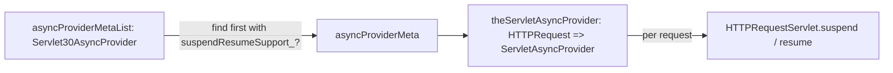

# Lift servlet provider architecture

This page describes the theory of operation of Lift's servlet adapter layer:
the container-neutral abstraction, the adapters, the asynchronous provider
seam, and how the test harness exercises the layer.

## The abstraction

Lift's web engine is written against container-neutral types, so the engine
never touches servlet classes directly. The abstraction is the `HTTPProvider`
trait (`net.liftweb.http.provider.HTTPProvider`):

* `context: HTTPContext` — the application's servlet context, abstracted.
* `bootLift(loader: Box[String])` — runs the application's boot (the class
  named by the `bootloader` filter init parameter, or `DefaultBootstrap`),
  then creates and initializes the `LiftServlet`.
* `service(req, resp)(chain)` — the request entry point: runs the request's
  early processing, wraps the loans (`CurrentHTTPReqResp`, `CurrentReq`,
  `URLRewriter`), decides via `isLiftRequest_?` whether Lift handles the
  request, and dispatches to `LiftServlet.service`; requests Lift does not
  handle fall through to `chain` (the rest of the filter chain).
* `terminate` — destroys the `LiftServlet` at application shutdown.

## The adapters

`net.liftweb.http.provider.servlet` holds the servlet implementations:

| Adapter | Wraps | Notes |
| --- | --- | --- |
| `ServletFilterProvider` | `Filter` | mixes `HTTPProvider` into a filter; `init` captures the `ServletContext` and boots Lift; `doFilter` wraps the loan handlers and dispatches |
| `HTTPRequestServlet` | `HttpServletRequest` | request facts, cookies, parameters; carries the async provider for this request |
| `HTTPResponseServlet` | `HttpServletResponse` | status, headers (Set-Cookie encoding via `CookieEncoder`), output stream; honors `LiftRules.overwrittenReponseHeaders` (set vs add) |
| `HTTPServletSession` | `HttpSession` | attribute delegation, invalidation, and the Lift-session bridge (`SessionToServletBridge`) |
| `HTTPServletContext` | `ServletContext` | resource lookup and streaming |

## The async provider seam

Long polling and Comet need a request to be suspended — its container thread
released — and later resumed with a response. The seam is the
`ServletAsyncProvider` trait
(`net.liftweb.http.provider.servlet.ServletAsyncProvider`):

```scala
def suspend(timeout: Long): RetryState.Value   // RetryState.SUSPENDED / TIMED_OUT / RESUMED
def resume(what: (Req, LiftResponse)): Boolean
def resumeInfo: Option[(Req, LiftResponse)]
def suspendResumeSupport_?: Boolean
```

Selection (`LiftRules`, at Lift boot): the registered provider list
(`LiftRules.asyncProviderMetaList`, readable, extended by `addSyncProvider`
before boot) holds the standard Servlet 3.0 provider; `asyncProviderMeta`
selects the first entry whose class-level `suspendResumeSupport_?` is true,
and `theServletAsyncProvider` vends a provider per request. Each request
additionally checks that the specific container request reports asynchronous
support (`HTTPRequestServlet.suspendResumeSupport_?`).



The standard provider is `Servlet30AsyncProvider`
(`net.liftweb.http.provider.servlet.containers.Servlet30AsyncProvider`): it
uses the Servlet 3.0 `AsyncContext` — `startAsync`, `setTimeout(0)` (the container async timeout is set to zero on suspend) — and on
resume writes the response through `LiftServlet.sendResponse` and completes
the context. The re-dispatched request is recognized by `resumeInfo` in
`LiftServlet.service`.

`LiftServlet.handleGenericContinuation` is the framework's async entry: it
schedules the reply body on a separate thread and either suspends the request
(async provider available) or waits on a future for up to
`LiftRules.cometRequestTimeout` seconds. The reply body runs detached from
request state; the response it produces is rendered with the request's state
applied (`wrapState`).

## The test harness

The webkit test suite runs Lift inside an embedded servlet container through
`net.liftweb.webapptest.JettyTestServer` (test tree): it starts Jetty 12
with the ee9 servlet environment (Servlet 5.0; Jetty 11 is end-of-life and
its 2026 security fixes exist only in Jetty 12) on a port, deploys the test
web application from `src/test/webapp` (whose `web.xml` declares
`LiftFilter`), and offers request helpers for the characterization tests. The test web
application's boot
(`web/webkit/src/test/scala/bootstrap/liftweb/Boot.scala`) registers the
snippet packages and the test dispatch tables (`ContainerVarTests`,
`LongPollingTests`, `UploadEchoTests`).

## Where the behavior is proven

Every behavior statement on this page that is user-visible is pinned by a
named test; the claim-to-test table is
[servlet-behavior-test-map.md](../servlet-behavior-test-map.md).
