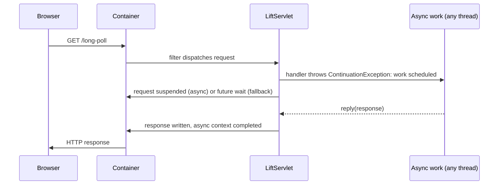

# Lift servlet integration

This page describes what a servlet container must provide to run Lift, how
Lift's types wrap the container's types, and how long polling travels from the
browser through the async provider to a CometActor and back.

## What a container must provide

Lift runs inside any servlet container as a servlet filter
(`net.liftweb.http.LiftFilter`, declared in the application's `web.xml` or
registered programmatically). The container must provide:

* the servlet filter lifecycle (`init`, `doFilter`, `destroy`) so Lift can
  boot and serve requests;
* request and response objects with headers, parameters, sessions, and input
  and output streams;
* servlet sessions with attributes and invalidation;
* for long polling and Comet: servlet asynchronous processing
  (`jakarta.servlet.AsyncContext`) — on containers that report asynchronous
  support, requests are suspended and their threads released; on containers
  that do not, Lift delivers the same contract using a future-based fallback.

## How Lift wraps the container types

Lift converts container types into container-neutral types behind the
`HTTPProvider` trait (`net.liftweb.http.provider.HTTPProvider`):

| Container type | Lift type | Notes |
| --- | --- | --- |
| `HttpServletRequest` | `HTTPRequestServlet` | exposes URI, query string, headers, cookies, parameters, remote address, content type; suspends/resumes for async |
| `HttpServletResponse` | `HTTPResponseServlet` | status, headers (with `Set-Cookie` encoding), output stream |
| `HttpSession` | `HTTPServletSession` | attribute read/write/remove, invalidation, max inactive interval; bridges to the Lift session via `SessionToServletBridge` |
| `ServletContext` | `HTTPServletContext` | resource lookup, context path, resource streaming |
| filter lifecycle | `ServletFilterProvider` | captures the `ServletContext` on `init`, boots Lift, and dispatches every request through `HTTPProvider.service` |

A request is handled by Lift when `isLiftRequest_?` decides so (path-based
rules and whether the URI names a static resource); otherwise the filter chain
continues and the container or other filters serve the request.

## Long polling: from browser to CometActor and back

When a request needs an answer that is ready later (long polling), Lift
application code runs it through `RestContinuation.async`:

```scala
RestContinuation.async { reply =>
  // later, from any thread:
  reply(XmlResponse(<done>42</done>))
}
```

The container-neutral flow:



Two mechanisms deliver the same contract, chosen per container by
`LiftRules.asyncProviderMeta` and `LiftRules.theServletAsyncProvider`:

* **Servlet 3.0 async** — `Servlet30AsyncProvider` calls `startAsync` on the
  request, sets the container timeout to zero (the container's default
  timeout applies), and on resume writes the response through
  `LiftServlet.sendResponse` and completes the async context. When the
  container dispatches the completed request again, `LiftServlet.service`
  recognizes the resumed request via `resumeInfo` and sends the stored
  response.
* **Fallback** — on containers without asynchronous support, the answer is
  computed on a scheduler thread and the request thread waits on a future for
  up to `LiftRules.cometRequestTimeout` seconds.

The selection runs at Lift boot: the first registered
`AsyncProviderMeta` whose `suspendResumeSupport_?` is true supplies the
provider function, and each request additionally checks that the container
reports asynchronous support for that specific request.

## Container versions

Lift's asynchronous provider list registers the standard Servlet 3.0
provider only (proven by
`AsyncProviderSelectionSpec."register only the standard servlet 3.0
provider"`). Containers that predate Servlet 3.0 asynchronous processing
cannot take the suspension path: requests take the future-based fallback,
which waits for the answer for up to `LiftRules.cometRequestTimeout`
seconds. On Servlet 3.0-capable containers, answers that exceed the budget
are still delivered (the client waits — proven by
`AsyncProviderFailsafeSpec."deliver a budget-exceeded answer on an
async-capable container"`).
